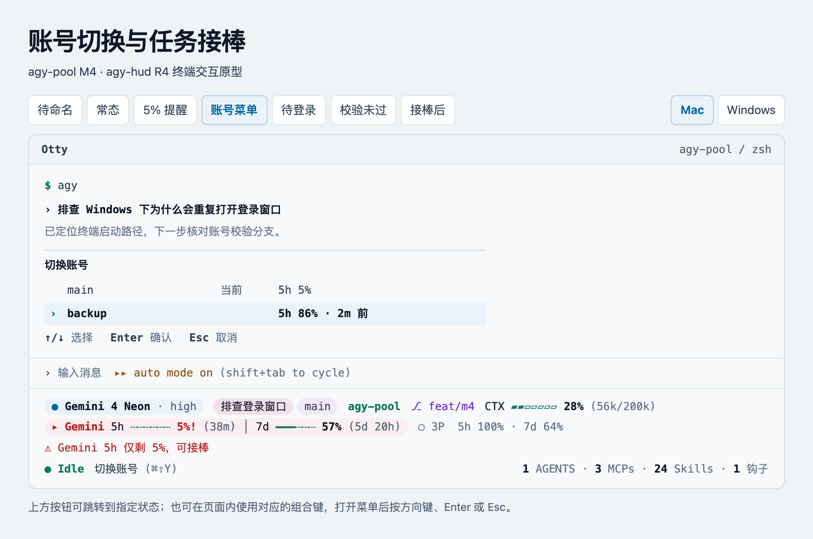

# agy-pool M4 PRD｜双账号接棒

| 项目 | 内容 |
|---|---|
| 版本 / 日期 | M4 · v1.1 / 2026-11-27 |
| 状态 | 产品范围已确认；尚未实现，平台能力待真机验收 |
| 目标环境 | macOS Otty、Windows Terminal；Antigravity CLI（`agy`）+ `agy-hud` + `agy-pool` |
| 仓库基线 | `agy-pool` 的 `m3`（`43d1224`）及 `feat/m4` 已有 Windows 终端与校验改动（`22fb265`） |
| 视觉基线 | [`agy-hud` R4「冰白微胶囊」](https://github.com/huachan5/agy-hud/blob/v2.2-mac-otty-r4-frosted-pills/docs/ui-spec-r4-frosted-pills.md)，标签 `v2.2-mac-otty-r4-frosted-pills`，提交 `89bd084d64605f42dcb298b472e332334e1f06fd` |
| 交互原型 | [打开 HTML 原型](agy-pool-M4-原型.html) · [静态原型图：常态](agy-pool-m4-idle.png) · [静态原型图：账号菜单](agy-pool-m4-accounts.png) |

本篇是 [原 PRD](agy-pool-PRD.md) 的 M4 增量，不替换既有注册、人工排障、交接包预算和并发保护约束。两者遇到冲突时，以本文对 **M4 主流程**的改动为准。

## 1. 目标与范围

用户平时照常在终端敲 `agy`。第一次发消息时自动登记；额度不足时 HUD 提醒；用户用快捷键选择另一个账号并完成官方要求的登录；本地后台整理并把上下文交给新对话。**主流程只用一个终端分屏，浏览器登录是例外；用户不敲 `agy-pool` 命令、不命名、不手动复制上下文。** 另一个终端可以选择查询任务，不参与主流程。

- **本期**：双账号（已登记的 `main`、`backup`）、首条 query 登记、原生标题回填、5 小时低额度提醒、键盘菜单、人工登录/自动接棒、任务查询、Mac 与 Windows 分别验收。
- **非目标**：无人值守换号、自动输入账号凭据或自动操作浏览器、后台杀进程、恢复或合并旧云端聊天、跨设备/账号同步原始聊天、第三个账号、可点击 HUD、后台模型取名。首次配置 HUD、托管入口和两个账号仍可单独完成。

## 2. 用户路径

1. 在当前分屏敲 `agy`，发第一条 query。HUD 能确认实际对话 ID 和首条用户消息后，后台建立任务 `T1`、第一棒。空开后退出不建任务。
2. HUD 显示 `todo` + `main` 两个胶囊；第一棒的 `agy` 生成标题后，回填为 `排查登录窗口` + `main` 两个胶囊。常态也显示 `切换账号 (⌘⇧Y)` / `切换账号 (Ctrl+Shift+Y)`。
3. 当前账号的 Gemini **5 小时**额度剩余 **≤ 5%** 时提醒。用户也可以不等提醒，主动打开菜单。
4. 在当前终端按快捷键。菜单列出两个账号、当前标记和可用的 5 小时额度；`↑/↓` 移动，`Enter` 确认，`Esc` 取消。选择当前账号不发起切换。
5. 确认后等当前轮停止，不强行打断。旧会话安全结束后整理本地交接包；按需提示用户用官方流程登录目标账号。此过程不要求旧账号回复或写总结。
6. 新鲜校验结果确认确实登录了目标账号后，才在同一个终端启动一条**新对话**，把读取交接包作为初始指令。拿到新对话 ID 后登记为 `T1` 的下一棒。HUD 更新为 `排查登录窗口` + `backup` 两个胶囊，任务名不被新棒的标题覆盖。
7. 任意时刻可以在另一个终端运行 `agy-pool list` 或 `agy-pool status T1 --json` 查看 ID、账号、棒次、对话 ID、交接状态。查询不领取交接包、不中断任务、不触发换号。

## 3. 功能需求

| 编号 | 需求与验收行为 |
|---|---|
| FR-01 自动登记 | 第一次启动 `agy` 不建空任务；以真实对话 ID 和可验证的首条用户消息为准。HUD 重绘、同一会话恢复、跨终端打开同一个旧对话不重复建任务。无有效 ID 时继续普通 `agy`，不猜测绑定。 |
| FR-02 命名与徽标 | 任务名来自**第一棒**的原生会话标题。未拿到就用 `todo`；拿到后回填，不截首句冒充标题、不额外调用模型。接棒不覆盖原任务名。HUD 分别用两个独立胶囊显示任务名和当前账号，无方括号或分隔符；隐藏任务 ID、棒次及重复标题；完整标题可通过查询查看。 |
| FR-03 低额提醒 | 用已归属当前账号的新鲜 **Gemini 5h** 读数。`5.0%` 触发，`>5%` 不触发；HUD 可持续表示低额状态，但同一任务、账号和重置窗口不重复发提醒。缺失/过期不记为 0%；7d 与 3P 可继续高亮，但不触发此次 M4 接棒提醒。提醒本身不预约、退出或换号。 |
| FR-04 快捷键菜单 | Mac `⌘ + Shift + Y`，Windows `Ctrl + Shift + Y`；`F8` 不用，`Shift+Tab` 仍交给原生审批模式。HUD 有托管任务时常驻文字提示，采用「操作名 (快捷键)」句式，低额态同样可见，不要求单击 HUD。打开菜单不换号，默认焦点在当前行，两行均可浏览；方向键不触发切换。 |
| FR-05 安全换号 | `Enter` 确认目标账号和**当前分屏的源任务**，不是确认该账号已经登录。等旧轮停止并退出后再换号；无可靠安全退出信号时提示 `/exit`。其他 `agy` 会话可能受共享登录影响时先阻止并提示。官方登录由用户操作，不模拟键盘或自动授权。 |
| FR-06 本地交接 | 在确认换号后，使用最后可用的本地日志、任务目标及进度/文件变更整理受限大小的交接包，继承既有脱敏和预算规则。对话正文不复制进任务库；日志未完整落盘时明确标为部分交接／待核对，没有任何可用内容则暂停。 |
| FR-07 新对话接棒 | 只有明确确认的换号意图可领取指定任务的交接包；该意图限定源任务、目标账号和启动实例。目标账号经新鲜证据验证后，才用 `agy` 的交互初始提示（`-i`）交付交接包。禁止发给错号、普通并行新会话或未确认的目标；同一意图最多启动一棒。 |
| FR-08 查询与隔离 | `list/status` 保留任务 ID 与棒次等信息。双分屏同目录、同账号的新对话各自登记；仅明确发起的接棒继承原任务 ID。普通新会话即使是同账号、同目录且只有一个待接任务，也不自动领取交接包。 |
| FR-09 平台兼容 | Mac/Windows 共用任务、状态和交接规则，各自负责按键路由、前台终端和官方登录适配。不可用终端的同窗降级详见 §5；保留 `agy-hud` 已有主题和审批快捷键。 |

## 4. 界面与文案

### 4.1 R4 落位

| 区域 | M4 变化 |
|---|---|
| 第 1 行：执行上下文 | 模型保留冰蓝 `#EBF3FA`、原有状态点和字重。右侧并列两个独立微胶囊：任务名用淡粉底 `#F4E0E9`、深墨字 `#0F172A`、常规字重（原型 `400`，终端不加粗）；账号名用灰紫底 `#EFEBF6`、紫灰字 `#554176`。任务与账号的间距小于它们与模型的间距，无方括号或分隔符。切换 `main` / `backup` 仅改账号文字，三个胶囊不随额度告警变色。任务标题不重复展示。 |
| 第 2 行：配额双池 | 仍然是 Gemini / 3P 两池（不是 `main` / `backup` 两个账号）。激活池 `#E8F5F3`，R4 危急底纹 `#FCEEEF` 和 `!` 保留；非活跃池无底纹。M4 账号接棒提示只关注 Gemini 5h，不能用 3P 或 Gemini 7d 的颜色代替行为判断，也不重复渲染两条相同换号行动提示。 |
| 动态活动区 | 低额、等待登录、部分交接、核验失败使用纯文本状态行，不铺底色。危险或阻塞用 R4 珊瑚红/琥珀及文字提示；成功仅显示短状态，不打印交接包源码或账号邮箱。 |
| 底行 | 保持 R4 左侧实时状态、右侧能力计数。把快捷键提示放在状态侧，如 `● Idle   切换账号 (⌘⇧Y)`；操作词次墨 `#334155`、括号提示柔灰 `#64748B`，语法参考 `auto mode on (shift+tab to cycle)`。这不是个可点的按钮；窄屏可将快捷键提示移到独立行，**不省略按键**。 |
| 账号菜单 | 原终端内两行键盘选择器，不新开终端，不用全屏模态。使用 `›` 标记焦点、`当前` 标记登录账号，焦点可用淡蓝底纹；不要将焦点误画成已切换。`↑/↓ 选择   Enter 确认   Esc 取消` 常驻菜单末行。 |

### 4.2 核心状态

原型内可切换 Mac / Windows、观察不同状态并操作键盘菜单；它使用示例数据，不连接真实账号或 `agy`。

| 状态 | 文案示例 | 操作 |
|---|---|---|
| 已登记、标题未回填 | `todo` + `main` 两个胶囊 | 正常聊天；无需取名 |
| 正常使用 | `排查登录窗口` + `main` 两个胶囊；`切换账号 (⌘⇧Y)` | 随时打开菜单 |
| Gemini 5h 低额 | `⚠ Gemini 5h 仅剩 5%，可接棒` | 用户自行决定是否打开菜单 |
| 菜单打开 | `main　当前　5h 5%` / `backup　5h 86% · 2m 前` | `↑/↓`、`Enter`、`Esc` |
| 已确认、源会话忙 | `已选 backup；等当前轮结束后接棒` | 继续等待；若无可靠自动退出路径，提示 `/exit` |
| 待官方登录 | `请完成 backup 的官方登录；交接包已保存` | 用户完成官方登录 |
| 目标账号核验失败 | `未确认已登录 backup，已保留交接包` | 核验成功才允许下一棒，不泄露凭据 |
| 接棒成功 | `排查登录窗口` + `backup` 两个胶囊，短暂 `✓ 已接棒` | 仍在同一终端继续 |

原型遵循 R4 冰白底 `#F7F9FA`、优先文字/符号表达状态。HTML 的轻微过渡只用于评审反馈：菜单出现、焦点移动、状态替换；实际终端以字符更新为准，不要求 CSS 动效或第三方依赖。窄终端保留 ANSI 矩形回退；胶囊不跨行断开，任务名截断也不挤掉账号名或快捷键。

## 5. 异常与恢复

| 场景 | 预期 |
|---|---|
| 终端收不到组合键或已被其他绑定占用 | 不抢 `agy` 键盘输入。不显示一个实际无效的快捷键；采用可用的提示「退出当前会话后选择账号」，在原终端用方向键选择。**降级通过不等于前台键位通过。** |
| HUD 未启用、坏帧、对话 ID 缺失 | 保持原生 `agy` 正常可用，不创建假任务，不对未托管会话展示可操作换号入口。等待有效事件或通过已有查询/排障入口核查。 |
| 备号额度过期或缺失／已为零 | 菜单标「额度未知／上次读数」而非 0%；先警示、不承诺足够。新鲜读数明确耗尽时保留待接棒状态，不打开下一棒。 |
| 当前轮忙、另一分屏仍运行 | 不杀进程，不在轮内静默换号。若登录态共享，提示先让受影响会话安全退出。任务隔离不当作账号隔离。 |
| 登录取消、登错、HUD 探针过期、启动失败 | 保持待接棒/交接包，明确失败点；不启动错账号，不把旧共享状态当新结果；重试先判定这一棒是否已启动。用户取消本地流程，不自动还原已经完成的官方登录。 |
| 中断在落盘到启动之间 | 重启后仍能查询待接棒状态，显式重试时复用已保存包；普通 `agy` 不会顺手恢复它。新对话启动后先确认是否已存在，避免重复开棒。 |
| 日志缺失或最后轮未写全 | 有目标/文件信息则做部分交接并标待核对；无可用内容则提示。不能把工具未完成的操作视为已执行，不盲目重放。 |

## 6. 验收与发布门槛

| 编号 | 可观察的验收结果 |
|---|---|
| AC-01 · FR-01/02 | 空开退出不出现任务；同一会话首次正常 query 后恰有一条任务。无标题为 `todo`；原生标题出现后原任务名回填，跨两次接棒保持同名。 |
| AC-02 · FR-03 | 模拟新鲜 Gemini 5h `5.1% / 5.0% / 0%` 和缺失、过期、仅 7d/3P 低额度。只有符合条件者提醒；批量 HUD 刷新不制造重复提醒或换号意图。 |
| AC-03 · FR-04/09 | 在 Mac Otty、Windows Terminal **实际 `agy` 前台运行**时分别试组合键；菜单仅两项，方向键移动、`Esc` 取消、当前账号 `Enter` 无切换、副号 `Enter` 只创建一个意图；`Shift+Tab` 审批仍正常。记录不可用终端及降级状态。 |
| AC-04 · FR-05/06/07 | `main → backup → main` 真机流程：手动完成官方登录；每次都在原终端产生新对话、先读交接包；任务 ID 不变、对话 ID 各异。用户不敲 `agy-pool`，也不复制上下文。用零额度的源会话日志夹具验证生成不调用模型。 |
| AC-05 · FR-05/07 | 人为制造账号错配、共享登录冲突、取消、重复确认、启动失败。不得把内容发给错误账号或重复启棒；失败后待接棒任务与交接包仍能查询/重试。 |
| AC-06 · FR-08 | Otty `⌘D` 同目录同账号开两个 `agy`，发首问后得到不同任务 ID；左侧准备接棒时右侧普通新任务不领取其交接包；查询不触发换号。Windows 执行等效分屏验收。 |
| AC-07 · FR-02/04/09 | 检查长中英文标题、窄终端、无 Nerd Font、正常/低额/异常状态。Otty R4 应保留冰蓝模型、淡粉常规字重任务名、灰紫账号三个独立胶囊；切换账号不换底色。快捷键提示和账号始终可读，任务 ID 不进入 HUD，非活跃池仍无底纹，Windows 既有主题不被 Otty 专用样式覆盖。 |

**发布需单独验证的能力**：真实首问帧与原生标题、`agy` 运行中的组合键路由、新鲜登录结果以及新对话的初始交接指令。`-i` 是已有入口，但不能代替实际验证会话是否正确读取交接包；没有真机证据不标注双平台通过。
