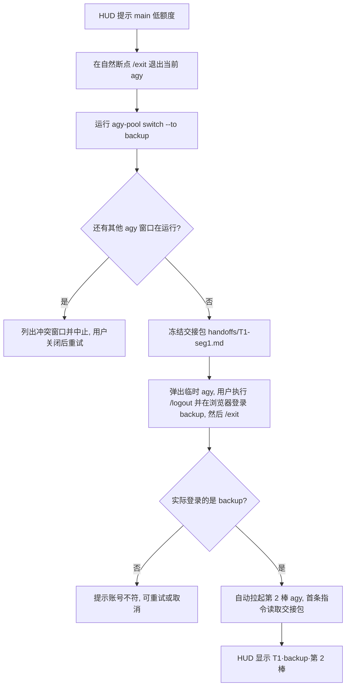
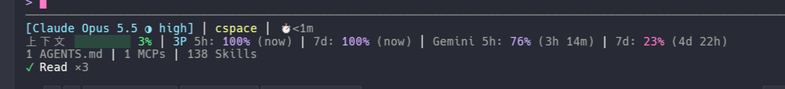
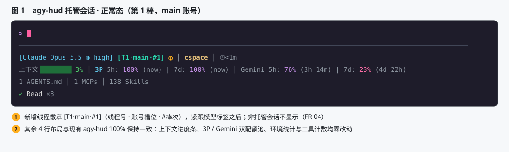
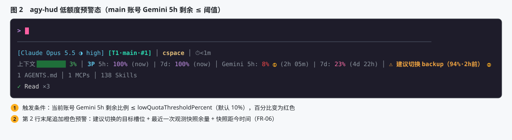
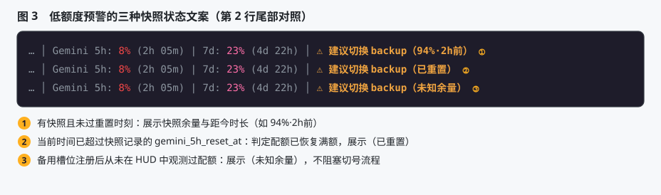
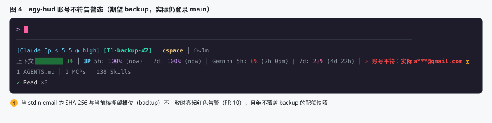
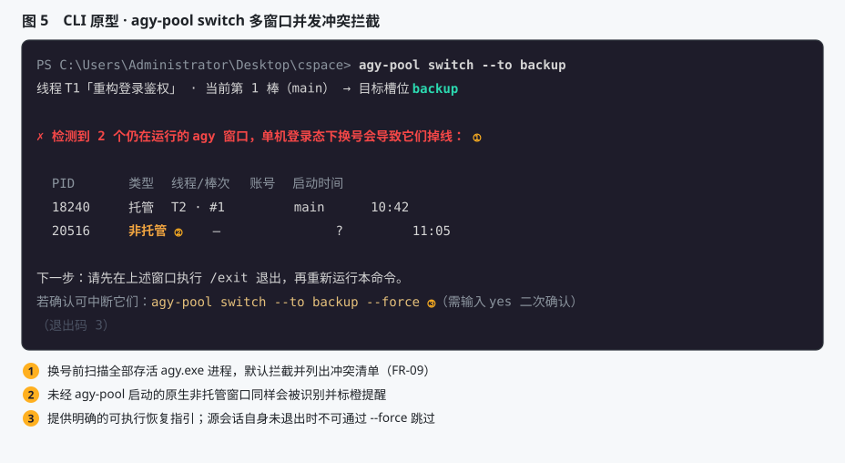
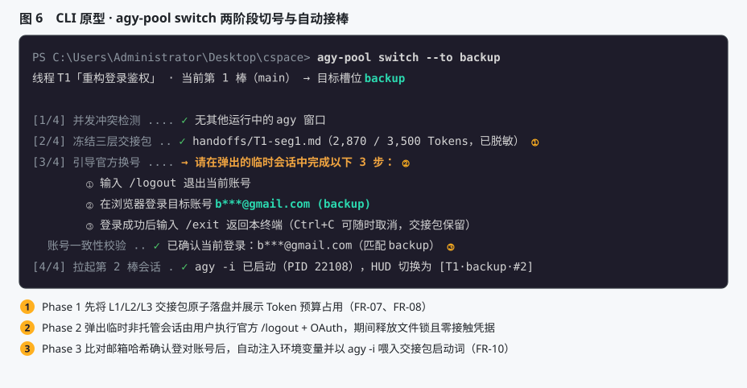
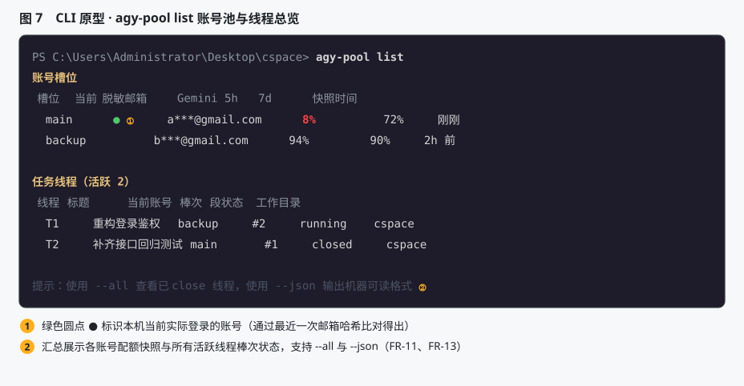

# `agy-pool` × `agy-hud` 双 Gemini 账号池与无缝接力 — 产品需求文档（PRD）

| 项 | 内容 |
|---|---|
| 版本 | v1.2（2026-11-26） |
| 状态 | 待确认（见 [§12 待确认问题](#12-待确认问题)） |
| 适用平台 | Windows 10/11 · Antigravity CLI（`agy`）· Python 3.12 |
| 配套文档 | [agy-pool-技术方案.md](agy-pool-技术方案.md)（实现细节以该文档为准，本文只讲“做什么、为什么、怎么算做完”） |
| 原型图目录 | [agy-pool-原型图/](agy-pool-原型图/)（含现状基线 PNG + 7 张高保真终端 SVG 原型图） |

> **一句话通俗理解（ELI5）**：把开发任务想象成一场**接力赛**。`agy-pool` 是**裁判兼交接员**——记住比赛目标、写好交接棒、确认换人安全后再让下一棒出发；`agy-hud` 是**场边大屏**——实时显示第几棒、谁在跑、体力（配额）快不够了。两者只通过“看板文件”沟通，互不越界。

### 修订记录

| 版本 | 变更摘要 |
|---|---|
| v1.0 | 初稿：问题定义、六大场景、ICE 优先级、10 条 AC，并内嵌了一份技术方案 |
| v1.1 | ① 移除与技术方案重复的“第二部分”，PRD 只保留需求；② 新增编号功能需求 FR、非功能需求 NFR、边界异常表、风险与里程碑；③ 修正 4 处需求矛盾（切号时源会话是否可运行、锚点“永不裁剪”与 L1 预算冲突、冲突检测漏掉非托管 `agy` 窗口、换号后无法确认登对账号）；④ 补齐账号注册、交接预览、取消切号、线程收尾等缺失命令；⑤ AC 扩充至 15 条并与 FR 双向映射 |
| v1.2 | 基于现有 `agy-hud` 真实界面截图，新增 **§4.4 界面与交互原型图**（00 现状基线 + 01~04 HUD 四态原型 + 05~07 CLI 核心交互原型，提供 SVG 高保真图与纯文本终端双视图） |

---

## 0. 术语速查

| 术语 | 通俗解释 |
|---|---|
| **线程（TaskThread，如 `T1`）** | 你要完成的“一件事”，跨账号、跨会话一直存在 |
| **锚点（Anchor）** | 这件事的“初心卡”：目标、验收标准、硬约束。每一棒都必须带上，**永不裁剪** |
| **棒次（Segment，如 `#2`）** | 一次真实的 `agy` 会话。线程 `T1` 的第 2 次会话即 `T1·#2` |
| **交接包（Handoff）** | 两棒之间传递的精简 Markdown（≤ 3,500 Tokens） |
| **账号槽位（Account，如 `main` / `backup`）** | 对一个 Gemini 账号的**别名 + 配额快照**，不含任何凭据 |
| **托管会话** | 由 `agy-pool` 拉起、带有 `AGY_POOL_*` 环境变量的 `agy`；其余皆为**非托管会话** |

---

## 1. 背景与问题

### 1.1 目标用户
在 Windows 终端高频使用 `agy` 推进长周期开发任务、常同时开 2~3 个终端窗口、手上有 **2 个 Gemini 账号**的个人开发者。

### 1.2 核心痛点

| # | 痛点 | 现状后果 |
|---|---|---|
| P1 | **配额打断心流** | 单账号 5h 配额触底就得换号，新会话是一张白纸，背景与已做决策全部丢失 |
| P2 | **手工交接贵且会走样** | 人工总结/复制历史 3~8 分钟一次；`A → B → A` 多轮后原始目标“传话走样” |
| P3 | **多窗口切号误伤** | 本机是**单登录态**：在一个窗口 `/logout` 会让所有正在跑的 `agy` 窗口一起掉线；同目录多任务还容易拿错上下文 |
| P4 | **配额信息割裂** | `agy-hud` 只能看到**当前**账号的 `Gemini 5h / 7d`，看不到备用账号还剩多少、该不该换 |

### 1.3 为什么现在做
- `agy-hud` 已能从 `stdin.quota` 实时读取配额、从 `stdin.email` 识别当前账号，**数据源已就绪**；
- `agy` 原生支持 `-i`（带首条指令进入交互会话），**自动拉起下一棒的通道已就绪**；
- 只差一个“记住任务 + 写交接棒 + 安全换号”的轻量编排层，投入小（纯标准库）、收益直接（每次换号省 3~8 分钟）。

---

## 2. 目标与成功指标

| 维度 | 当前基线 | Phase 1 目标 | 度量口径 |
|---|---|---|---|
| **切号机器耗时** | 3~8 分钟（全手工） | **≤ 15 秒** | 从执行 `agy-pool switch` 到新 `agy` 进程启动，**扣除**人工 OAuth 登录与确认等待时间；取 10 次实测 P90 |
| **目标一致性** | 2 棒以上常丢约束 | **100%** | 每份交接包 L1 段必含：锚点全文 + `task.md` 进度 + `git diff --stat`（单测断言） |
| **交接包体积** | 全量 `transcript.jsonl` 数十万 Token | **≤ 3,500 Tokens** | 用 10 万行超大日志夹具做单测 |
| **切号误伤** | 无任何检测 | **0 次**误切 | 存在其他存活 `agy` 进程（含非托管）时，100% 拦截或显式确认（集成测试） |
| **账号登错检出** | 无 | **100%** | 换号后实际登录账号与目标槽位不符时必须告警（单测 + 真机演练） |
| **零凭据** | N/A | **0 条** | 落盘文件中 Token / Cookie / API Key 命中数为 0（脱敏单测 + 静态扫描） |
| **HUD 零退化** | — | **100%** | 非托管会话的 HUD 输出与改造前逐字节一致（回归测试） |

**非目标（Non-goals）**：不追求全自动无人值守换号；不做多机同步；不提升单账号配额本身。

---

## 3. 范围

| 类别 | 内容 |
|---|---|
| **In Scope（Phase 1）** | 账号槽位注册与配额快照；线程/锚点管理；L1/L2/L3 交接包生成与预算裁剪；托管启动与多终端隔离；两阶段切号（可中断、可重入、可取消）；切号前并发冲突检测（含非托管 `agy` 进程）；换号后账号一致性校验；`agy-hud` 徽章、低额度提醒、账号不符告警；`status / list` 状态查看；线程收尾 |
| **Out of Scope（永不做）** | ❌ 读取/导出/篡改 Windows 凭据管理器、浏览器 Cookie、OAuth Token；❌ `agy-hud` 接管终端、模拟按键 `/logout`、杀 `agy` 进程；❌ 跨账号合并云端历史会话（只靠本地交接包桥接） |
| **Deferred（Phase 2）** | 3+ 账号自动路由；后台预热会话（`ConversationService`）；配额重置倒计时通知；交接包可视化 diff；`doctor` 自检；回切原账号时 `agy -r` 续用旧会话；交接包自动清理 `gc` |

---

## 4. 用户场景与流程

### 4.1 核心场景

| # | 场景 | 用户操作 | 系统反馈 / HUD 表现 |
|---|---|---|---|
| S0 | **注册账号（一次性）** | 用 `main` 登录 `agy` 后运行 `agy-pool account add main --from-current`；换 `backup` 登录后同理 | 从 `agy-hud` 状态文件读取当前邮箱，只保存**脱敏提示 + 哈希**用于后续校验 |
| S1 | **开新线程** | `agy-pool start "重构登录鉴权" --account main` | 创建 `T1`，打开锚点模板供填写（超长会拒绝），拉起托管 `agy`。HUD 第 1 行出现 `[T1·main·#1]` |
| S2 | **日常写代码** | 正常对话 | HUD 显示徽章，并把 `conversation_id`、配额、账号哈希写回看板；**非托管窗口外观 0 变化** |
| S3 | **低额度提醒** | `main` 的 `Gemini 5h` 剩余 ≤ 阈值（默认 8%） | HUD 第 2 行尾部：`⚠ 建议切换 backup（94%·2h前）`；若备用账号已过重置点则显示 `（已重置）` |
| S4 | **切号接力** | 在自然断点 `/exit` 退出，运行 `agy-pool switch --to backup` | ① 冲突检测 → ② 冻结交接包 → ③ 引导完成官方换号并**校验登对账号** → ④ 自动拉起 `[T1·backup·#2]` 并喂入交接包 |
| S5 | **多窗口并行** | 终端 1 跑 `T1`，终端 2 跑 `T2`（可同目录） | 各自持有独立线程身份互不串台；终端 1 发起切号时若终端 2（或任何非托管 `agy`）仍在运行，**默认拦截并列出冲突清单** |
| S6 | **回切原账号** | 配额重置后 `agy-pool switch --to main` | 基于 `#2` 生成新交接包，锚点依旧完整置顶，拉起 `[T1·main·#3]` |
| S7 | **反悔/中断** | 切号途中 `Ctrl+C`，或 `agy-pool switch --cancel` | 重跑 `switch` 从断点续接；`--cancel` 回到切号前状态，交接包保留备查 |

> **线程省略规则**：命令未写线程号时，依次取 ① 环境变量 `AGY_POOL_THREAD_ID`；② 当前目录下唯一的活跃线程；③ 仍有歧义则报错并列出候选。

### 4.2 切号主流程（用户视角）



### 4.3 用户故事

| 编号 | 用户故事 | 对应 FR |
|---|---|---|
| US-01 | 作为开发者，我想一条命令为任务建线程并写下初心，以便换几次号都不跑偏 | FR-02, FR-03 |
| US-02 | 作为开发者，我想在 HUD 上一眼看到线程/账号/棒次和低额提醒，以便在自然断点提前交接 | FR-04, FR-06 |
| US-03 | 作为开发者，我想工具自动从对话、`task.md`、Git 变更提炼交接包，以便新账号秒懂现状又不撑爆上下文 | FR-07 |
| US-04 | 作为开发者，我想切号过程可中断、可重试、可取消，切完自动开新会话 | FR-08, FR-12 |
| US-05 | 作为常开多窗口的开发者，我想同目录不同任务互不串台，且切号前自动拦住还在跑的其他窗口 | FR-03, FR-09 |
| US-06 | 作为开发者，我想换号后工具能确认我登对了账号，以免把 `main` 当成 `backup` 继续烧配额 | FR-01, FR-10 |
| US-07 | 作为开发者，我想任务完成后把线程收尾，以免状态列表越来越乱 | FR-13 |

### 4.4 界面与交互原型图（HUD & CLI Prototypes）

> 原型矢量图位于桌面同级目录 [agy-pool-原型图/](agy-pool-原型图/)，严格对齐现有 `agy-hud` 4 行布局、配色与分隔符（主段 ` │ `、子桶 ` | `）。下方同时提供图片与等宽文本对照。

#### （0）现状基线：非托管 `agy` 会话（零变化参照）


```text
> █
──────────────────────────────────────────────────────────────────────────────────────────────────────────────────
[Claude Opus 5.5 ◑ high] │ cspace │ ⏱<1m
上下文 ████████ 3% │ 3P 5h: 100% (now) | 7d: 100% (now) │ Gemini 5h: 76% (3h 14m) | 7d: 23% (4d 22h)
1 AGENTS.md │ 1 MCPs │ 138 Skills
✓ Read ×3
```
- **设计约束（NFR-02）**：未通过 `agy-pool` 启动的普通 `agy` 窗口，输出与上图**逐字节一致**。

---

#### （1）`agy-hud` 托管会话 · 正常态（对应 FR-04）


```text
> █
──────────────────────────────────────────────────────────────────────────────────────────────────────────────────
[Claude Opus 5.5 ◑ high] [T1·main·#1] │ cspace │ ⏱<1m
                         ^^^^^^^^^^^^ ① 新增青绿色线程徽章：[线程号·账号槽位·#棒次]
上下文 ████████ 3% │ 3P 5h: 100% (now) | 7d: 100% (now) │ Gemini 5h: 76% (3h 14m) | 7d: 23% (4d 22h)
1 AGENTS.md │ 1 MCPs │ 138 Skills
✓ Read ×3
```

---

#### （2）`agy-hud` 托管会话 · 低额度预警态（对应 FR-06）


```text
> █
──────────────────────────────────────────────────────────────────────────────────────────────────────────────────
[Claude Opus 5.5 ◑ high] [T1·main·#1] │ cspace │ ⏱<1m
上下文 ████████ 3% │ 3P 5h: 100% (now) | 7d: 100% (now) │ Gemini 5h: 8% (2h 05m) | 7d: 23% (4d 22h) │ ⚠ 建议切换 backup（94%·2h前）
                                                                     ^^ ① ≤阈值变红                   ^^^^^^^^^^^^^^^^^^^^^^^^^^^^^^ ② 尾部橙色换号建议
1 AGENTS.md │ 1 MCPs │ 138 Skills
✓ Read ×3
```

---

#### （3）低额度预警的三种快照状态文案（对应 FR-06）


```text
① 有快照且未到重置点：  … │ Gemini 5h: 8% (2h 05m) | 7d: 23% (4d 22h) │ ⚠ 建议切换 backup（94%·2h前）
② 已过快照记录重置点：  … │ Gemini 5h: 8% (2h 05m) | 7d: 23% (4d 22h) │ ⚠ 建议切换 backup（已重置）
③ 备用号从未观测配额：  … │ Gemini 5h: 8% (2h 05m) | 7d: 23% (4d 22h) │ ⚠ 建议切换 backup（未知余量）
```

---

#### （4）`agy-hud` 托管会话 · 账号不符告警态（对应 FR-10）


```text
> █
──────────────────────────────────────────────────────────────────────────────────────────────────────────────────
[Claude Opus 5.5 ◑ high] [T1·backup·#2] │ cspace │ ⏱<1m
上下文 ████████ 3% │ 3P 5h: 100% (now) | 7d: 100% (now) │ Gemini 5h: 8% (2h 05m) | 7d: 23% (4d 22h) │ ⚠ 账号不符：实际 a***@gmail.com
                                                                                                      ^^^^^^^^^^^^^^^^^^^^^^^^^^^^^^^ ① 红色告警，优先级高于低额提醒
1 AGENTS.md │ 1 MCPs │ 138 Skills
✓ Read ×3
```

---

#### （5）CLI 原型 · `agy-pool switch` 多窗口并发冲突拦截（对应 FR-09）


```text
PS C:\Users\Administrator\Desktop\cspace> agy-pool switch --to backup
线程 T1「重构登录鉴权」 · 当前第 1 棒（main） → 目标槽位 backup

✗ 检测到 2 个仍在运行的 agy 窗口，单机登录态下换号会导致它们掉线：

  PID       类型      线程/棒次       账号      启动时间
  18240     托管      T2 · #1         main      10:42
  20516     非托管    —               ?         11:05

下一步：请先在上述窗口执行 /exit 退出，再重新运行本命令。
若确认可中断它们：agy-pool switch --to backup --force（需输入 yes 二次确认）
（退出码 3）
```

---

#### （6）CLI 原型 · `agy-pool switch` 两阶段切号与自动接棒（对应 FR-07、FR-08、FR-10）


```text
PS C:\Users\Administrator\Desktop\cspace> agy-pool switch --to backup
线程 T1「重构登录鉴权」 · 当前第 1 棒（main） → 目标槽位 backup

[1/4] 并发冲突检测 .... ✓ 无其他运行中的 agy 窗口
[2/4] 冻结三层交接包 .. ✓ handoffs/T1-seg1.md（2,870 / 3,500 Tokens，已脱敏）
[3/4] 引导官方换号 .... → 请在弹出的临时会话中完成以下 3 步：
        ① 输入 /logout 退出当前账号
        ② 在浏览器登录目标账号 b***@gmail.com (backup)
        ③ 登录成功后输入 /exit 返回本终端（Ctrl+C 可随时取消，交接包保留）
      账号一致性校验 .. ✓ 已确认当前登录：b***@gmail.com（匹配 backup）
[4/4] 拉起第 2 棒会话 . ✓ agy -i 已启动（PID 22108），HUD 切换为 [T1·backup·#2]
```

---

#### （7）CLI 原型 · `agy-pool list` 账号池与线程总览（对应 FR-11、FR-13）


```text
PS C:\Users\Administrator\Desktop\cspace> agy-pool list
账号槽位
  槽位      当前  脱敏邮箱            Gemini 5h   7d      快照时间
  main      ●     a***@gmail.com      8%          72%     刚刚
  backup          b***@gmail.com      94%         90%     2h 前

任务线程（活跃 2）
  线程   标题               当前账号   棒次   段状态     工作目录
  T1     重构登录鉴权       backup     #2     running    cspace
  T2     补齐接口回归测试   main       #1     closed     cspace

提示：使用 --all 查看已 close 线程，使用 --json 输出机器可读格式
```

---

## 5. 功能需求（FR）

| 编号 | 需求 | 优先级 | 验收 |
|---|---|---|---|
| FR-01 | **账号槽位注册**：`account add <id> --from-current` 从 `agy-hud` 状态文件读取当前登录邮箱，仅保存脱敏提示（`a***@gmail.com`）与哈希；支持 `account list / remove` | Must | AC-01 |
| FR-02 | **线程与锚点**：`start` 创建唯一线程号与锚点文件；锚点上限 **600 Tokens**，超限拒绝并提示精简；支持 `anchor edit` 修改后重新校验 | Must | AC-02, AC-12 |
| FR-03 | **托管启动与终端隔离**：拉起 `agy` 时注入线程/棒次/账号环境变量；同目录多线程各自独立 | Must | AC-02, AC-07 |
| FR-04 | **HUD 徽章**：托管会话第 1 行显示 `[线程·账号·#棒次]`；非托管会话 0 变化 | Must | AC-03, AC-10 |
| FR-05 | **实时遥测回传**：HUD 把会话 ID、日志路径、配额、账号哈希写入本棒专属看板文件（节流，失败静默） | Must | AC-03 |
| FR-06 | **低额度预警**：当前账号 `Gemini 5h` 剩余 ≤ 阈值时提示目标槽位、快照余量与快照时间；已过重置点显示“已重置” | Must | AC-04 |
| FR-07 | **交接包生成**：按 L1（现状）/ L2（对话精华）/ L3（溯源指针）三层生成，总量 ≤ 3,500 Tokens，出库前脱敏；`handoff` 命令可单独预览 | Must | AC-05, AC-06, AC-11 |
| FR-08 | **两阶段切号**：冻结交接包 → 官方换号 → 校验 → 拉起下一棒；源会话进程仍存活时不得进入换号步骤 | Must | AC-05, AC-13 |
| FR-09 | **并发冲突保护**：单登录态下，换号前检测所有其他存活的 `agy` 进程（托管 + 非托管），默认拦截并列清单；`--force` 需二次确认 | Must | AC-07, AC-14 |
| FR-10 | **账号一致性校验**：换号后比对实际登录账号与目标槽位；不符则阻止拉起（可重试/取消），运行中发现不符则 HUD 告警 | Must | AC-08 |
| FR-11 | **状态查看**：`status`（当前线程详情）、`list`（全部线程与账号快照），均支持 `--json` | Should | AC-15 |
| FR-12 | **中断恢复**：切号任一步中断后状态完整；重跑 `switch` 幂等续接；`switch --cancel` 回滚到切号前 | Must | AC-09 |
| FR-13 | **线程收尾**：`close <tid>` 标记完成，从 HUD 提示与默认列表中隐藏，文件保留 | Should | AC-15 |
| FR-14 | **同账号续棒**：`resume <tid>` 用最新交接包在**当前账号**开新一棒（用于上下文过长时“清空重来”） | Could | — |

---

## 6. 非功能需求（NFR）

| 编号 | 类别 | 要求 |
|---|---|---|
| NFR-01 | 安全 | 零凭据：不读写任何 Token/Cookie/API Key；落盘前强制脱敏；邮箱只存脱敏提示与哈希 |
| NFR-02 | 兼容 | 无 `AGY_POOL_*` 环境变量、或看板文件缺失/损坏时，`agy-hud` 输出与改造前一致且不抛异常 |
| NFR-03 | 性能 | 托管会话下 HUD 单次渲染新增耗时 **≤ 5 ms（P95）**，不新增任何子进程；非托管会话新增耗时 ≈ 0 |
| NFR-04 | 可靠 | 所有状态写入原子化；任意时刻进程崩溃/断电后状态文件可读，最坏丢失最后一次未提交操作 |
| NFR-05 | 依赖 | 纯 Python 3.12 标准库，零第三方依赖；`agy-hud` 不 import `agy-pool` |
| NFR-06 | 体验 | 辅助子进程（git、探活）不弹黑框；所有错误给出“下一步怎么做”的中文提示 |
| NFR-07 | 可追溯 | 关键操作（建线程、冻结、换号、拉起、回滚）写入本地事件日志，便于复盘 |

---

## 7. 优先级（ICE × MoSCoW）

> ICE = Impact × Confidence × Ease（各 1~10），按得分降序。

| 编号 | 能力 | I | C | E | ICE | MoSCoW | 归属 |
|---|---|---:|---:|---:|---:|---|---|
| C1 | 数据模型 + 状态原子存储与文件锁 | 10 | 10 | 8 | **800** | Must | Phase 1 |
| C2 | 三层交接包生成 + Token 预算裁剪 + 脱敏 | 10 | 9 | 8 | **720** | Must | Phase 1 |
| C3 | `agy -i` 拉起新会话 + 终端隔离 | 10 | 9 | 8 | **720** | Must | Phase 1 |
| C6 | `agy-hud` 最小侵入联动（徽章 / 回传 / 低额提醒） | 9 | 9 | 8 | **648** | Must | Phase 1 |
| C10 | 账号注册 + 换号后一致性校验 | 9 | 8 | 8 | **576** | Must | Phase 1 |
| C7 | `status / list / close` | 7 | 9 | 9 | **567** | Should | Phase 1 |
| C4 | 两阶段切号 + 取消/回滚/重入 | 10 | 8 | 7 | **560** | Must | Phase 1 |
| C5 | 并发冲突检测（托管 + 非托管进程探活） | 9 | 8 | 7 | **504** | Must | Phase 1 |
| C8 | 后台预建会话 | 6 | 7 | 5 | 210 | Could | Phase 2 |
| C9 | 3+ 账号路由 + 重置倒计时 | 5 | 7 | 5 | 175 | Could | Phase 2 |

---

## 8. 验收标准（Given / When / Then）

| 编号 | Given | When | Then | FR |
|---|---|---|---|---|
| AC-01 | 已用 `main` 登录且 `agy-hud` 渲染过一次 | `account add main --from-current` | 状态中仅有 `main` 的脱敏邮箱与哈希，无明文邮箱、无凭据 | FR-01 |
| AC-02 | 合法目录、已注册双账号 | `start "xxx" --account main` | 生成唯一线程号与锚点；拉起的 `agy` 带有线程/棒次/账号环境变量 | FR-02, FR-03 |
| AC-03 | 托管会话 | HUD 渲染 | 第 1 行含 `[T1·main·#1]`；本棒看板文件被写入且节流 | FR-04, FR-05 |
| AC-04 | `main` 的 5h 剩余降到阈值以下 | HUD 渲染 | 第 2 行尾部显示目标槽位、快照余量与快照时间；过重置点显示“已重置” | FR-06 |
| AC-05 | 源会话已退出、无冲突、换号校验通过 | `switch --to backup` | 生成 `handoffs/T1-seg1.md`（≤ 3,500 Tokens）；`#1` 变为已交接；以 `agy -i` 拉起 `#2` | FR-07, FR-08 |
| AC-06 | 经历 `main → backup → main` | 生成第 3 份交接包 | L1 仍完整包含初始锚点全文 | FR-07 |
| AC-07 | 同目录 `T1`、`T2` 同时运行 | 各自 HUD 渲染与写回 | 徽章、看板文件、交接包互不串台 | FR-03, FR-09 |
| AC-08 | 换号时用户误登 `main` | 校验步骤 | 拒绝拉起并提示“实际登录 a***，期望 b***”，可重试/取消；运行中发现不符时 HUD 显示 `⚠ 账号不符` | FR-10 |
| AC-09 | 已冻结交接包，用户 `Ctrl+C` | 再次 `switch` / `switch --cancel` | 状态文件完整；续接时复用已冻结交接包；取消时回到切号前状态 | FR-12 |
| AC-10 | 原生 `agy` 启动，或状态文件缺失/损坏 | HUD 渲染 | 输出与改造前逐字节一致，无异常 | FR-04, NFR-02 |
| AC-11 | 日志中混入 API Key / Bearer / OAuth Token | 生成交接包与写看板 | 全部替换为 `[REDACTED]`；状态文件键名守卫通过 | FR-07, NFR-01 |
| AC-12 | 锚点内容超过 600 Tokens | `start` / `anchor edit` | 拒绝保存并提示当前 Token 数与上限 | FR-02 |
| AC-13 | 源会话进程仍存活 | `switch` | 可以冻结交接包，但**不进入换号步骤**，提示先 `/exit` | FR-08 |
| AC-14 | 存在一个非托管 `agy` 窗口 | `switch` | 冲突清单中列出该进程 PID 与启动时间；`--force` 需输入 `yes` 确认 | FR-09 |
| AC-15 | 有 2 个活跃线程、1 个已收尾线程 | `list` / `status --json` | 默认只列活跃线程；`--all` 显示全部；JSON 可被解析 | FR-11, FR-13 |

---

## 9. 边界与异常清单

| 情形 | 期望行为 |
|---|---|
| 状态文件损坏 / 版本过高 | 命令拒绝写入并提示从自动备份恢复；HUD 静默降级为原样输出 |
| `transcript.jsonl` 缺失或损坏 | 交接包 L2 标注“对话记录不可用”，L1/L3 照常生成 |
| 工作目录不是 Git 仓库 | L1 的 Git 段写“非 Git 仓库”，不报错 |
| 交接包超预算 | 按“L3 → L2 最老轮次 → L2 单轮长度”顺序裁剪，L1 永不裁剪 |
| `stdin.quota` 缺失（未登录/接口变化） | HUD 不显示低额提醒，徽章照常；配额快照保持上次值并标注时间 |
| 备用账号从未被观测过配额 | 提示显示 `（未知余量）`，不阻止切号 |
| 两个终端同时 `switch` | 文件锁保证串行，后到者等待最多 5 秒后提示重试 |
| 新 `agy` 拉起后 3 秒内退出 | 本棒标记为失败，交接包保留，提示检查 `agy` 安装/登录状态 |
| 用户直接关掉终端窗口 | 下次任意命令通过进程探活把该棒标记为已结束 |
| PID 被系统复用 | 探活同时比对进程启动时间，不会误判为“仍在运行” |

---

## 10. 依赖、假设与风险

| 类型 | 内容 | 应对 |
|---|---|---|
| 依赖 | `agy` 的 `-i` 参数、交互内 `/logout` 与浏览器 OAuth 登录（已核实 `agy --help` **无** logout 子命令） | 手动引导模式；技术方案 M0 预研验证 |
| 依赖 | `agy-hud` 的 `stdin.quota`、`stdin.email`、`conversation_id` 字段 | 字段缺失时降级（见 §9）；回归测试锁定字段解析 |
| 假设 | 本机为单登录态：换号影响所有 `agy` 进程 | FR-09 冲突检测正是为此设计 |
| 风险 | **服务条款合规**：用多账号规避单账号配额可能不符合 Google 相关条款 | 上线前由用户自行确认条款；工具定位为“同一人名下多账号的上下文交接”，不提供批量注册或自动轮换能力 |
| 风险 | `agy` 升级后 stdin JSON 或 `-i` 行为变化 | 解析全部容错；`agy-hud` 回归测试覆盖；版本变化写入事件日志 |
| 风险 | 交接包质量不足导致新棒“理解偏差” | 启动词要求新棒先复述目标与下一步再动手；锚点强制置顶 |

---

## 11. 里程碑

| 里程碑 | 交付内容 | 完成标准 |
|---|---|---|
| M0 预研（0.5 天） | 验证 `-i` 长中文参数、`/logout` 影响范围、`stdin.email` 可用性 | 三项结论写入技术方案 §15 |
| M1 内核 | 数据模型、状态存储、交接包生成 | AC-06/11/12 单测通过 |
| M2 编排与 CLI | 适配器、编排器、CLI、安装脚本 | AC-01/02/05/08/09/13/14/15 通过（Fake 适配器） |
| M3 HUD 联动 | `agy-hud` 徽章、回传、预警 | AC-03/04/07/10 通过 + 原 13 项回归全绿 |
| M4 真机演练 | 双窗口 + `main → backup → main` 全流程 | §2 全部指标实测达标 |

---

## 12. 待确认问题

| # | 问题 | 选项 | 建议 |
|---|---|---|---|
| Q1 | 本机双账号的切换方式 | A. 引导式官方换号（`/logout` + 浏览器登录）<br>B. `GEMINI_API_KEY` 环境变量隔离<br>C. 外部合法切号命令 | **A**（零凭据、最贴合现状）；B 可作为无冲突的进阶模式 |
| Q2 | 低额度预警阈值 | 8% / 10% / 15% / 20% | **8%**（已拍板）：充分利用配额，触达 8% 时触发提醒再切换 |
| Q3 | 发现非托管 `agy` 进程时 | 默认拦截 / 仅警告 | **默认拦截**（`--force` 二次确认放行） |
| Q4 | 锚点上限 | 600 / 800 Tokens | **600**：保证 L1 其余部分有足够空间 |
| Q5 | 交接包保留期 | 永久 / 30 天 | Phase 1 **永久**保留，Phase 2 再做 `gc` |
